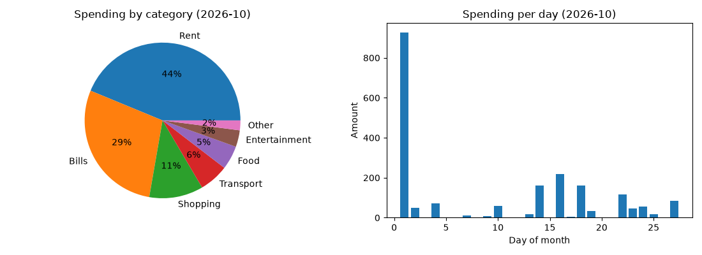

# Expense Tracker

A simple command-line app to log and categorize expenses, then see monthly summaries and charts.

**Tech:** Python, SQLite, Pandas, Matplotlib



## Setup

```
pip install -r requirements.txt
python expense_tracker.py
```

## Features

- Add expenses (date, category, description, amount) with input validation
- View and delete expenses
- Monthly report: total spent and spending per category
- Charts: pie chart by category and bar chart by day (saved as `report_YYYY-MM.png`)

Data is stored in `expenses.db` (created automatically next to the script).

## Try it with sample data

```
python examples/sample_data.py
python expense_tracker.py
```

Then choose **4** (report) or **5** (charts) and enter month `2026-10`.
Sample data is only added if your database is empty.

## Run the tests

```
python -m unittest
```

## Project files

| File | Purpose |
| --- | --- |
| `expense_tracker.py` | The app (menu, database, reports, charts) |
| `examples/sample_data.py` | Adds fake expenses for a quick demo |
| `examples/screenshot.png` | Example chart output |
| `test_expense_tracker.py` | Unit tests |
